<div align="center">

# Tasjeel · تسجيل

**Bilingual supplier onboarding on SAP BTP: from registration to a Business Partner in SAP S/4HANA.**

SAPUI5 · Fiori Elements · SAP CAP · OData V4 · S/4HANA Business Partner API · XSUAA · HANA Cloud

**[Live on SAP BTP](https://85cc730atrial-dev-tasjeel.cfapps.ap21.hana.ondemand.com)** · [Learning log](docs/learning-log.md)

</div>

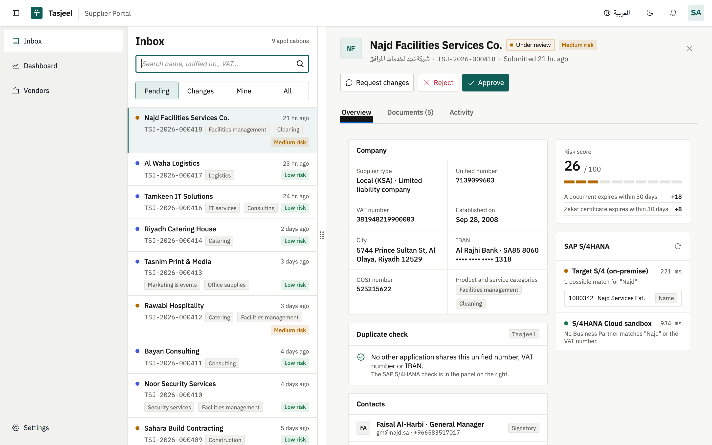

Suppliers register through a guided, bilingual (Arabic / English, full RTL) wizard that saves as they type. Procurement reviewers work the queue in a keyboard-driven inbox with risk scoring and duplicate detection. On approval, the supplier is created as a **Business Partner in SAP S/4HANA**, with clear handling when S/4 is unavailable.

The scenario is modelled on Saudi supplier registration: unified (CR) number, ZATCA VAT number, Saudi IBAN, National Address, GOSI and Zakat certificates.

> **Status:** deployed on SAP BTP (Cloud Foundry, ap21 trial) with HANA Cloud, the HTML5 Application Repository and a standalone approuter. Approvals on BTP create the Business Partner in an "on-premise" S/4 on a laptop through the SAP Cloud Connector ([how](docs/cloud-connector.md)). See the [roadmap](#roadmap).
>
> **About the live link:** sign-in is with an SAP ID, and the app only opens for users who hold a `Tasjeel_*` role collection; everyone else sees the "no access yet" screen. The database is a free-tier HANA Cloud instance that stops every night, so the app may be unavailable until it is restarted. For a full walkthrough, run it locally (below).

---

## Highlights

| | |
|---|---|
| **Supplier home** | A status tracker with real dates, one clear next step per status (continue, withdraw to edit, fix flagged fields), document expiry reminders and messages from procurement. |
| **Draft-based wizard** | 9 steps on CAP's draft handling: autosave on every change, resume on any device, and a live "what's still needed" list driven by the same server rules that block submission. |
| **Saudi-grade validation** | Unified number, VAT (`3…3`, 15 digits), IBAN mod-97 with live bank detection and SWIFT fill, National Address, document expiry. Arabic-Indic digits are normalized server-side. |
| **Reviewer inbox** | `FlexibleColumnLayout`, deep links, J/K/Esc triage, explainable risk score, duplicate detection (unified no., VAT, IBAN), PDF preview, activity timeline, internal or shared comments. |
| **Decisions with guardrails** | Approve, request changes on specific fields (the supplier's wizard reopens on them), reject with a reason and a 5-second undo. Status transitions are enforced by a server-side state machine. |
| **S/4HANA integration** | Through the **SAP Cloud Connector** (Destination → Connectivity → tunnel) to an on-premise S/4. Duplicate check against that system and the public S/4HANA Cloud sandbox. Approval creates an organization BP plus VAT number. Timeouts, a visible failed state, and an **idempotent retry** that never creates a second BP. |
| **Security** | XSUAA scopes → role templates → role collections; approuter with login, CSRF and logout; row-level ownership (`createdBy = $user`, including history and messages); the UI adapts to roles, the server enforces them. |
| **Fiori Elements** | Approved-vendor list report and object page generated purely from CDS annotations. |
| **Bilingual by design** | Every label, message, code list and validation error in EN/AR; RTL layout, mirrored icons and bidi-safe mixed text. Light and dark themes over SAP Horizon. |

## Screenshots

| Supplier home (registered in SAP) | Supplier wizard (IBAN → bank detected) |
|---|---|
| 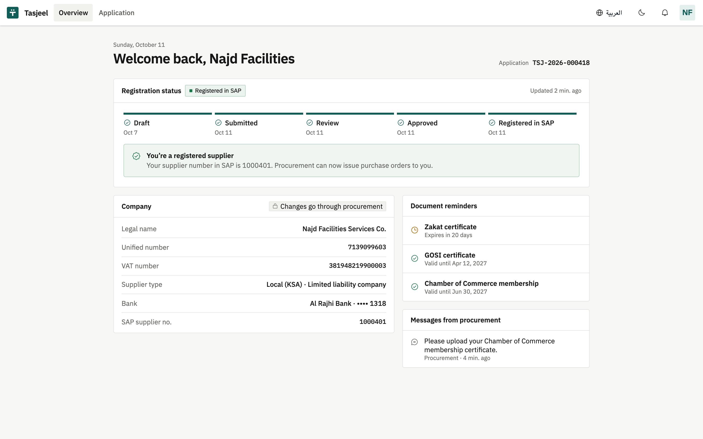 | 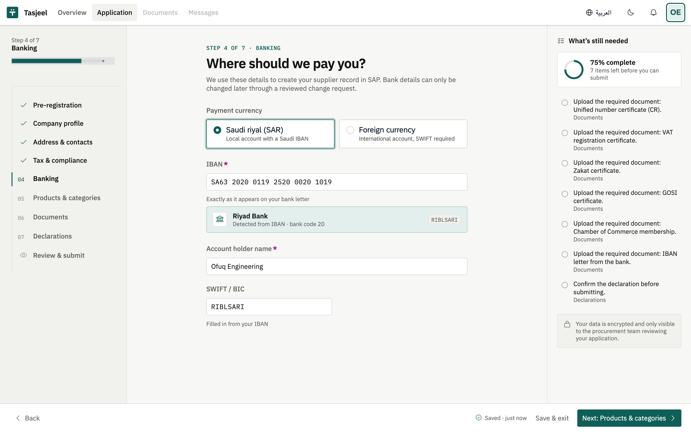 |
| **Reviewer dashboard** | **Sign-in** |
| 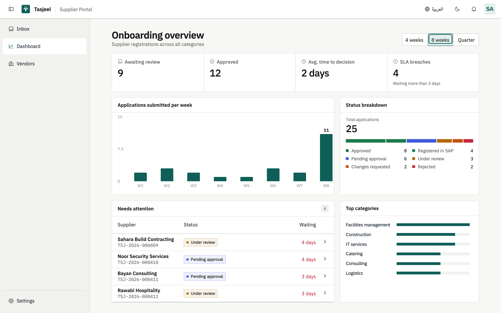 | 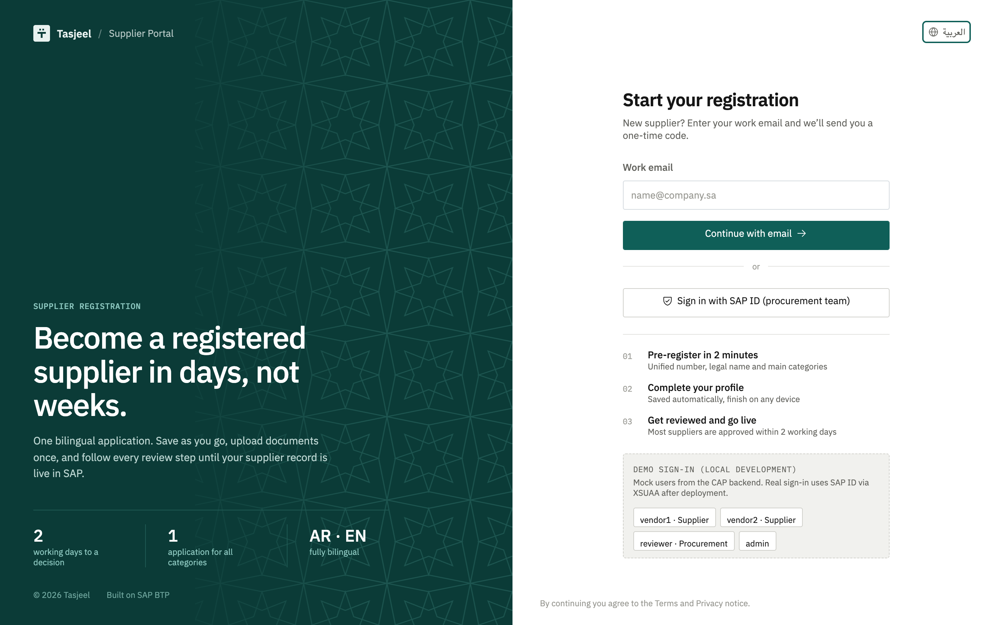 |
| **Arabic, dark theme** | **Arabic wizard** |
| 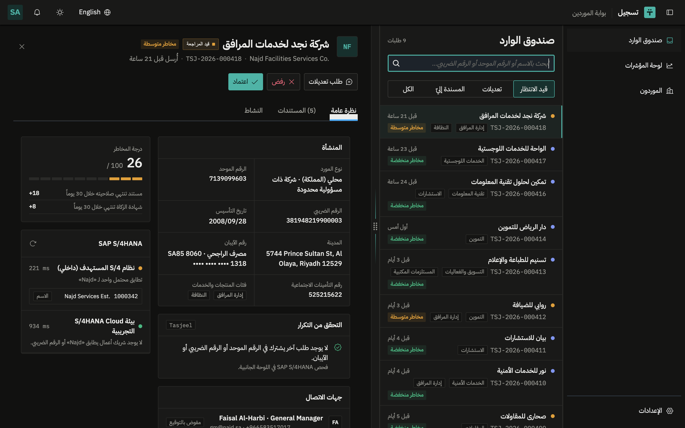 | 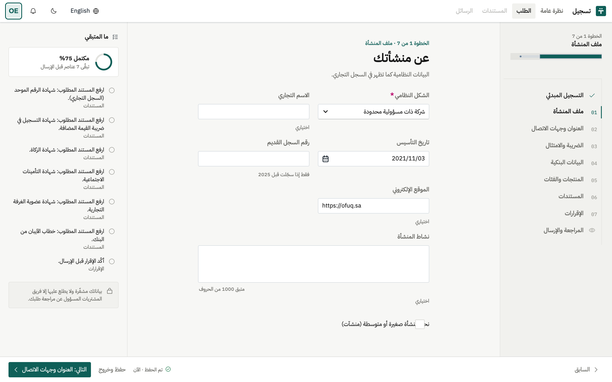 |
| **Fiori Elements: approved vendors** | **On a phone, in Arabic** |
| 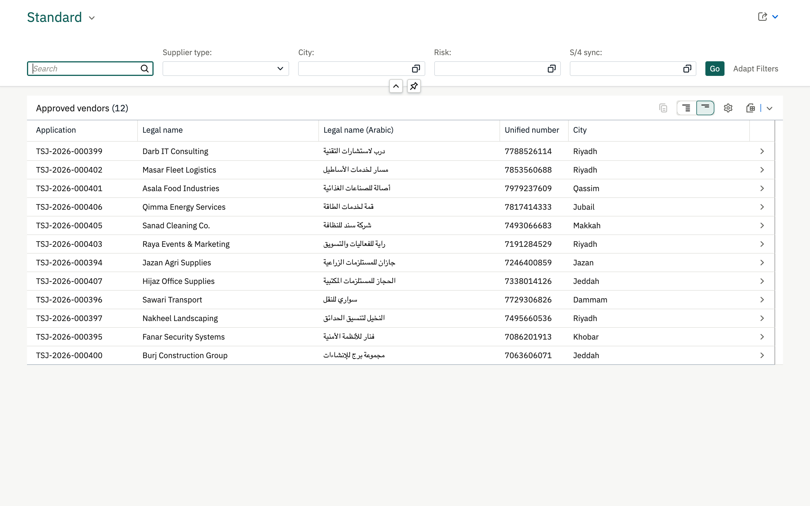 | 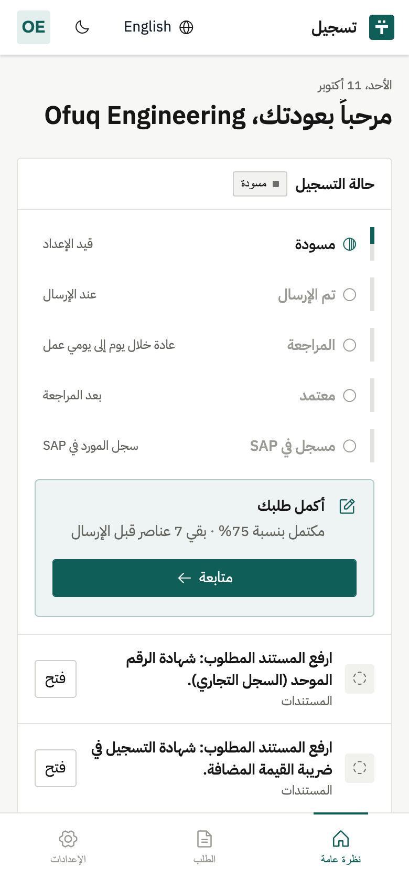 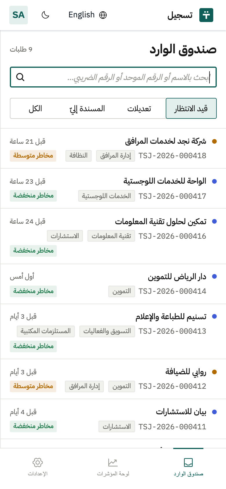 |

## Architecture

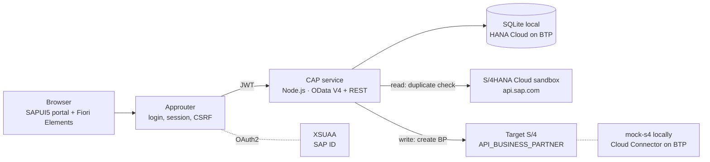

| Service | Path | Who |
|---|---|---|
| `ApplicantService` | `/odata/v4/applicant` | Suppliers (`Applicant`); draft-enabled, sees only their own application |
| `ReviewService` | `/odata/v4/review` | Procurement (`Reviewer`): queue, decisions, risk, duplicates, S/4 check and sync |
| `StatsService` | `/rest/stats` | Dashboard numbers (`Reviewer`) |
| `AdminService` | `/odata/v4/admin` | Master data (`Admin`) |
| `UserService` | `/rest/user/me` | Signed-in identity and roles, for the UI |

**S/4HANA sync in one picture:** approve → `APPROVED` + `PENDING` → create BP (5 s timeout) → `REGISTERED` + `SYNCED`, or stays `APPROVED` + `FAILED` with the error → **Retry sync** looks up `SearchTerm2 = application no.` first, so a BP created by a lost response is adopted instead of duplicated.

## Tech stack

| Layer | Tech |
|---|---|
| UI | Freestyle **SAPUI5** 1.148 LTS (XML views, custom controls with renderer API v2, OData V4 model), **Fiori Elements** (sap.fe), LESS theme over `sap_horizon`, Phosphor icons, IBM Plex Sans / Arabic / Mono |
| Backend | **SAP CAP** 10 (Node.js 24, ESM), CDS with compositions, code lists with `_texts`, draft, `@restrict` |
| Integration | CAP remote services (OData V2), `API_BUSINESS_PARTNER` imported from the sandbox `$metadata`, OData V2 adapter for the mock |
| Security | **XSUAA** (`@sap/xssec` 4), **`@sap/approuter`** |
| Tests | `cds.test` + `node:test`: **63 API tests** covering the lifecycle, validation, S/4 sync and failure paths, and an authorization matrix |

## Getting started

Requirements: Node.js 24 (`.nvmrc`). The CDS CLI comes from the project's dev dependencies (`npx cds`).

```bash
npm install
npm install --prefix mock-s4
npm run mock:s4        # mock on-premise S/4 (OData V2) on :4006, keep it running
npm run watch          # http://localhost:4004/portal/webapp/index.html
npm test               # 63 tests, no external calls
```

Locally, CAP's mocked authentication is used. The welcome page offers demo users:

| User | Role | Lands on |
|---|---|---|
| `vendor1` | Supplier with an application under review | Home |
| `vendor2` | Supplier with a draft in progress | Home → continue the wizard |
| `reviewer` | Procurement reviewer | Inbox |
| `admin` | Admin + reviewer | Dashboard |

**Optional: S/4HANA Cloud sandbox check.** Get a free API key on [api.sap.com](https://api.sap.com), copy `.cdsrc-private.example.json` to `.cdsrc-private.json` (gitignored) and paste the key. Without it the sandbox shows as unreachable and everything else works.

**Simulate an S/4 outage** to see the failed-sync and retry path:
```bash
curl -XPOST localhost:4006/mock/outage -H 'content-type: application/json' -d '{"on":true}'
```

### Deploy to SAP BTP

Prerequisites: a BTP trial (Cloud Foundry), the `cf` CLI with the MultiApps plugin, and `mbt`.

```bash
# HANA Cloud database inside the CF space (free tier; choose your own admin password)
cf create-service hana-cloud hana-free tasjeel-hana -c '{"data":{"edition":"cloud","memory":16,"systempassword":"<password>","whitelistIPs":["0.0.0.0/0"]}}'

npm run build:mta       # mbt build → mta_archives/tasjeel_1.0.0.mtar
npm run deploy          # cf deploy
```

Then assign a `Tasjeel_*` role collection to your user (Security → Role Collections) and open the `tasjeel` app's route. The free HANA instance stops nightly; start it again with `cf update-service tasjeel-hana -c '{"data":{"serviceStopped":false}}'`.

### Hybrid mode: real SAP login against BTP

```bash
cf create-service xsuaa application tasjeel-auth -c xs-security.json
npx cds bind auth --to tasjeel-auth
npm install --prefix app/router
npm run hybrid          # CAP on :4008, validates real JWTs
npm run router:hybrid   # approuter on http://localhost:5001
```

Assign one of the role collections `Tasjeel_Applicant`, `Tasjeel_Reviewer` or `Tasjeel_Admin` to your user in the BTP cockpit (Security → Role Collections). Without one, the app shows a "no access yet" screen and every service answers 403.

## Project structure

```
tasjeel/
├─ app/
│  ├─ portal/            freestyle UI5 app: supplier wizard, reviewer inbox, dashboard
│  │  └─ webapp/         controller/ view/ control/ (custom controls) css/less/ i18n/ (EN + AR)
│  ├─ vendors/           Fiori Elements list report + object page
│  └─ router/            approuter (xs-app.json, signed-out page)
├─ db/
│  ├─ schema.cds         applications, contacts, documents, history, comments, code lists
│  └─ data/              code lists with Arabic texts + demo data
├─ srv/
│  ├─ *-service.cds/.js  applicant, review, stats, admin, user services
│  ├─ annotations.cds    Fiori Elements annotations
│  ├─ lib/               validators, workflow (state machine, risk), rules, S/4 integration
│  └─ external/          imported API_BUSINESS_PARTNER contract + mock behaviour
├─ mock-s4/              mock "on-premise" S/4 serving the real BP API over OData V2
├─ test/                 API tests
├─ docs/                 learning log, screenshots
└─ xs-security.json      scopes, role templates, role collections
```

## Roadmap

- [x] **0** Toolchain and project skeleton
- [x] **1** Design system and screens in Figma (IBM Plex, Phosphor, Horizon-based tokens)
- [x] **2** CAP domain model, draft, validation rules, workflow, tests
- [x] **3** UI5 shell, theme bridge, i18n, RTL, custom controls
- [x] **4** Supplier wizard: draft autosave, live validation, uploads, submit
- [x] **5** Reviewer inbox, decisions, dashboard, Fiori Elements vendor list
- [x] **6** S/4HANA: duplicate check, Business Partner creation, failure handling and retry
- [x] **7** XSUAA roles, approuter, real identity in the UI, authorization tests
- [x] **8** Deploy to BTP: MTA, HANA Cloud, HTML5 repository, standalone approuter (SAP Build Work Zone site pending)
- [x] **9** Cloud Connector: approval on BTP creates the Business Partner on-premise ([setup](docs/cloud-connector.md))
- [ ] **10** CI/CD, linting, UI tests

## What I learned

Each phase has an entry in [`docs/learning-log.md`](docs/learning-log.md): the SAP concepts involved (draft, OData V4 binding, XSUAA, remote services and more) and the real bugs that testing surfaced, along with how they were fixed.
