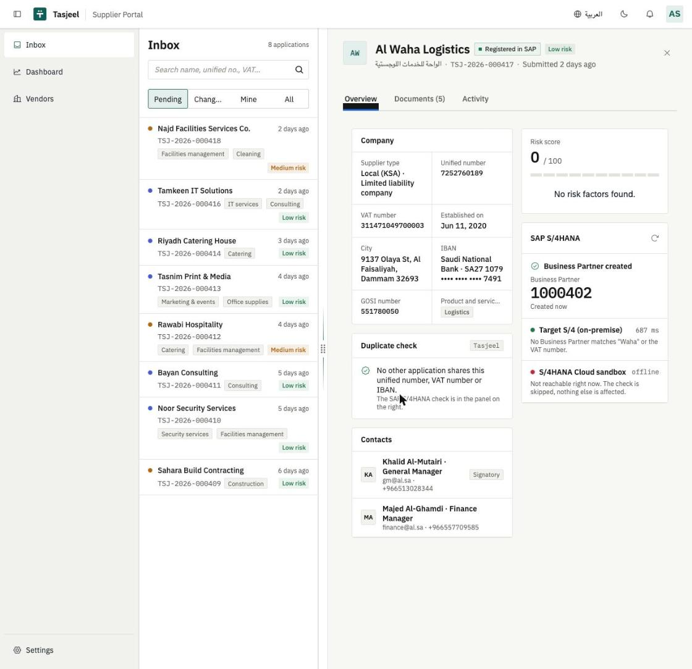
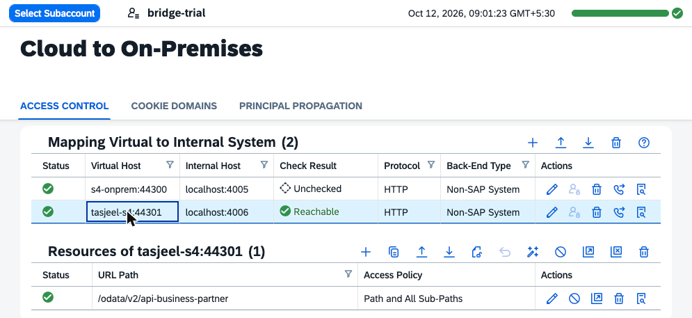

# Cloud Connector: deployed Tasjeel → S/4 on a laptop

When a reviewer approves a supplier in the deployed app, the Business Partner is created in an "on-premise" S/4
(`mock-s4`, the real `API_BUSINESS_PARTNER` contract over OData V2) running on a laptop. Nothing on the laptop is
exposed to the internet: the SAP Cloud Connector opens an **outbound** TLS tunnel to the BTP subaccount.

```
tasjeel-srv (CF) ─► Destination TASJEEL_S4_ONPREM (OnPremise) ─► Connectivity proxy ─► tunnel ─► Cloud Connector ─► localhost:4006 (mock-s4)
```



## Pieces

| Piece | Where | Value |
|---|---|---|
| Destination | `tasjeel-destination` instance, created by `mta.yaml` (`init_data`) | `TASJEEL_S4_ONPREM`: `http://tasjeel-s4:44301`, ProxyType **OnPremise**, NoAuthentication |
| CAP config | `package.json` → `cds.requires.API_BUSINESS_PARTNER.[production]` | `destination: TASJEEL_S4_ONPREM`, `path: /odata/v2/api-business-partner` |
| Connectivity | `tasjeel-connectivity` (lite), bound to `tasjeel-srv` | provides the proxy for OnPremise destinations |
| Cloud Connector mapping | Cloud To On-Premises → Access Control | virtual `tasjeel-s4:44301` → internal `localhost:4006`, HTTP, Non-SAP System, no principal propagation, Host header = virtual host |
| Allowed resources | same mapping → Resources | only `/odata/v2/api-business-partner` (Path and All Sub-Paths) |



The same Cloud Connector also serves another project (`s4-onprem:44300`); each app has its own virtual host and its own
destination name, so they don't interfere.

## Setup

1. Run the mock S/4: `npm run mock:s4` (port 4006).
2. Cloud Connector (already installed and connected to the subaccount): add the mapping and the one resource above.
   *Check Internal Host* should report **Reachable**.
3. Deploy (`npm run build:mta && npm run deploy`). The MTA creates `TASJEEL_S4_ONPREM` in the app's destination service,
   so nothing has to be typed in the cockpit.

## Verify

- In the reviewer detail, the SAP S/4HANA panel shows **Target S/4 (on-premise)** green with its latency.
- Approve an application → status **Registered in SAP** with the BP number.
- On the laptop:
  `curl "localhost:4006/odata/v2/api-business-partner/A_BusinessPartner?\$filter=SearchTerm2 eq 'TSJ-2026-000417'&\$format=json"`
- mock-s4's log shows the calls that came through the tunnel: duplicate check, the idempotency lookup by
  application number, then `POST A_BusinessPartner` (201) and the VAT tax number.

## Failure modes (what the reviewer sees)

| Situation | Result in Tasjeel |
|---|---|
| mock-s4 stopped, or the Cloud Connector stopped | Duplicate check shows the on-premise system as offline; approval stays **Approved** with "S/4HANA sync failed", message and attempt count; **Retry sync** finishes it later without creating a duplicate |
| Path not in the Cloud Connector resources | Same as above (the proxy denies the call); the Cloud Connector audit log shows the denied path |
| `POST /mock/outage {"on":true}` on mock-s4 | Simulated S/4 outage (503) for demos of the retry path |

Note: mock-s4 keeps its data in memory, so Business Partners created through the tunnel disappear when it restarts.
